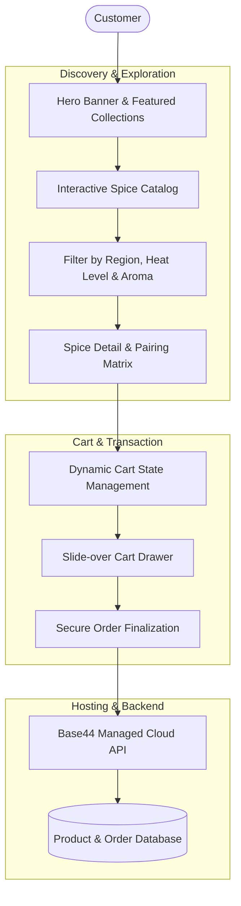

# 🌿 Spice Vault

**A Modern Spice Discovery & Artisan Culinary E-Commerce Experience**

[Explore the Live Store →](https://quadra-spice-flow.base44.app)

---

## 📖 Overview

**Spice Vault** is a responsive culinary discovery platform designed to connect home chefs and gourmets with rare, sustainably sourced whole spices. It combines an immersive visual catalog with detailed origin stories, aroma profiles, pairing suggestions, and a streamlined cart and checkout flow.

---

## 🛍️ User Journey & Architecture

---

## ✨ Features

- **Sensory Discovery Engine**: Filter spices by origin, flavor profile (warm, earthy, zesty, pungent), and heat index.
- **Pairing Matrix**: Interactive guides suggesting complementary herbs, culinary traditions, and storage recommendations.
- **Fluid Cart & Checkout**: Slide-out cart drawer with instant quantity modification and real-time total calculation.
- **Mobile-First Responsive Layout**: Built with modern CSS Grid and Flexbox for seamless browsing on phones, tablets, and desktops.

---

## 🔗 Live Application
Experience the live application hosted at:
**[https://quadra-spice-flow.base44.app](https://quadra-spice-flow.base44.app)**

---

## 📄 License
MIT License © [Shrikar G S](https://github.com/shrikargs7-cloud)
